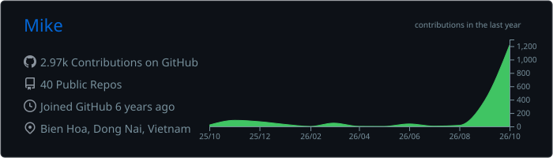
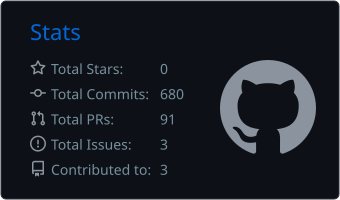
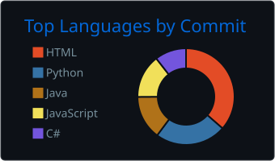
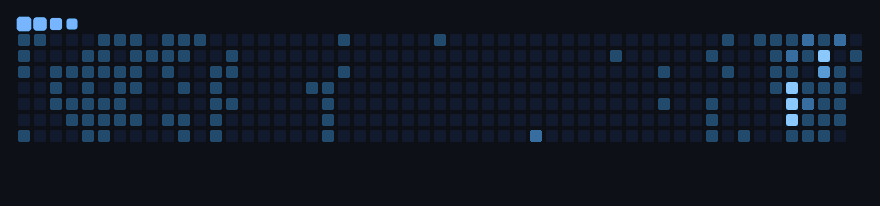

# Hey, I'm Mike! 👋

**Developer • Creative builder • Curious about pretty much everything**

*I like making things — useful apps, random experiments, games, tools, and whatever idea gets stuck in my head.*

Based in Vietnam 🇻🇳 &nbsp;·&nbsp; Always learning, always building.

  

  

---

## 👋 A little about me

I'm a developer who enjoys exploring **different kinds of projects**, from web applications and business tools to AI, games, automation, and embedded systems.

I don't really stick to one category. Sometimes I build something to solve a problem; sometimes it's just because I want to see if an idea is possible. I enjoy learning new tools, figuring things out, and turning rough ideas into something real.

**Outside of tech?** Games, anime, and probably thinking about the next project I want to try.

> *I may have more project ideas than free time — but that's part of the fun.*

## 💼 Experience & working style

- **Manufacturing environment:** Experience working in a factory / manufacturing setting, with an understanding of real operational needs, business workflows, and practical software solutions.
- **English & international communication:** Strong English communication skills. Comfortable communicating in English and familiar with US and European working environments and communication styles.
- **People + problem-solving:** I enjoy collaborating, discussing requirements, understanding what people need, and figuring out how technology can help.

I like the balance between **building software that works** and **making it easy for people to actually use**.

## 🛠️ Things I've worked with

| Area | Technologies & tools |
| :--- | :--- |
| **Web & application development** | TypeScript, JavaScript, React, .NET, Java, Python |
| **Enterprise & data** | SharePoint / SPFx, SQL, Firebase |
| **Cloud & deployment** | Cloudflare, Render, GitHub |
| **Game development** | Unity, Phaser |
| **Other interests & experience** | Embedded systems, AI tools, bots & automation |

Not a ranking or a claim to know everything — just a mix of tools I've used and areas I've explored.

## 🚀 Some things I've built

A few examples of the different directions my curiosity has taken me:

| Project | What it is |
| :--- | :--- |
| **🌱 Living Garden** | A cozy browser farming game about growing, exploring, and building your own little world. |
| **🤖 [Asumi](https://github.com/HoenMike/DiscordMikeBot)** | A Discord bot / AI companion with conversations, community features, and automations. |
| **☁️ Miraei** | A personal Telegram assistant for remembering ideas, organizing thoughts, and getting things done. |
| **🕒 [Word Clock](https://yet-another-vietnamese-word-clock.pages.dev/)** | A Vietnamese word clock for web and ambient displays, adapted from an [open-source project](https://github.com/tridzfr/vietnamese-word-clock). |

<b>📂 More projects & experiments</b>

 

- **Zinit** — my graduation thesis: a Flutter productivity app for tasks, habits, and focus.
- **AlphaCMS 2** — a private scheduling and payroll management web application.
- **[Chrome Dino](https://github.com/HoenMike/ChromeDino)** — an early Java/OOP game project.
- **ChillTown** — a real-time multiplayer experiment.
- **Project SC** — an independent private software project; details aren't public.

Some projects are public, some are private, and some are just experiments. They're all part of the journey.

## 📊 GitHub activity

<table>
<tr>
<td width="56%" align="center">

</td>
<td width="44%" align="center">

</td>
</tr>
</table>

Generated daily from public GitHub data. Private and non-GitHub work won't all show up here.

A little animation, because why not? 🐍

---

### Thanks for stopping by!

*Whether you're here to talk tech, check out my work, or just say hi — welcome.*

**See you around! ✌️**

Stats by [github-profile-summary-cards](https://github.com/vn7n24fzkq/github-profile-summary-cards) · Snake by [snk](https://github.com/Platane/snk) · Pixel GIF from [pixelartgifs](https://github.com/hackwithdev/pixelartgifs)

