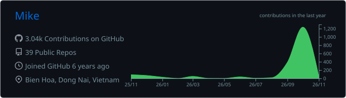
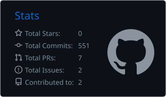
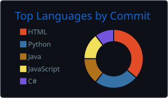
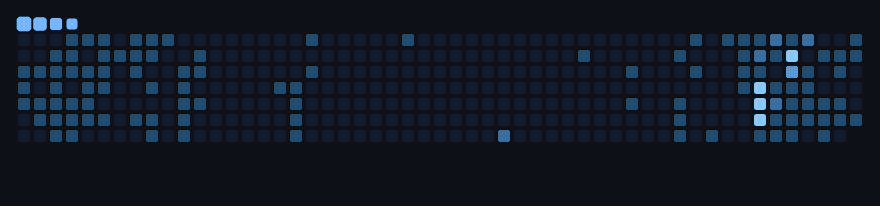

<!--
  HoenMike's GitHub profile
  Theme: Anime Night / RPG side quests
  The illustrated banner is an original, locally hosted SVG asset.
-->

<div align="center">



<br />

<a href="https://github.com/DenverCoder1/readme-typing-svg">
  
</a>

<br />

<a href="https://github.com/HoenMike?tab=repositories">
  
</a>
<a href="https://yet-another-vietnamese-word-clock.pages.dev/">
  
</a>
<a href="https://github.com/HoenMike/DiscordMikeBot">
  
</a>

<sub>「ようこそ！」 Welcome to my little corner of GitHub. Grab a drink, pick a quest, and stay a while.</sub>

</div>

---

## 🌙 01 / Character sheet — 自己紹介


Hey, I'm **Mike** — a computer science developer from **Vietnam** who likes making useful things with a little personality.

My main quest is turning ideas into working software. My side quests? **AI companions, cozy games, web apps, automation**, and experiments that begin with *"wait, what if..."*

```yaml
player: Mike / HoenMike
class: Developer + Curious Builder
home_server: Vietnam 🇻🇳
main_quest: Build things that are actually fun to use
side_quests:
  - Web apps and practical software
  - AI assistants, bots and automation
  - Cozy games and weird little prototypes
offline_mode: Anime, games, and more project ideas
playstyle: Curious > min-maxing
```

I also enjoy the less glamorous side of software: **understanding real workflows, talking to people, and solving practical problems**. Working around manufacturing and business processes taught me that a nice interface means little if it doesn't help the people using it.

<br clear="right" />

## ⚔️ 02 / My equipment — 技術スタック

<div align="center">

**Main loadout**


**Side-quest gear**


<sub>Inventory, not a power ranking — some tools are daily drivers; others belong to past experiments.</sub>

</div>

## 🗺️ 03 / Quest board — 進行中

A few adventures from the backlog:

| Quest | What I'm building | Portal |
| :--- | :--- | :--- |
| 🌱 **Living Garden** | A cozy browser farming game about growth, little rituals, and making a garden that keeps expanding. | [Visit the garden](https://living-garden.hoanggg003.workers.dev/) |
| 🤖 **Asumi** | A Discord companion with AI chat, community features, utilities, and automation. | [Source code](https://github.com/HoenMike/DiscordMikeBot) |
| 🕒 **Word Clock** | A playful Vietnamese word clock for the web — because time can look cooler than numbers. | [Try it](https://yet-another-vietnamese-word-clock.pages.dev/) |
| 🦖 **Chrome Dino** | A small Java game experiment from an earlier coding arc. | [Source code](https://github.com/HoenMike/ChromeDino) |

<details>
<summary><b>📜 Open the archive — previous arcs & experiments</b></summary>

<br />

- **Zinit** — a Flutter productivity app built as a graduation project.
- **AlphaCMS 2** — private scheduling and payroll software.
- **ChillTown** — an experiment in real-time multiplayer.
- **Other prototypes** — web utilities, internal business tools, AI experiments, and ideas that didn't need to become full products.

Not everything here has a public repository, and that's okay. The fun part is learning something with every build.

</details>

## 🍡 04 / Otaku corner — 趣味の時間

> **Life philosophy:** Ship the feature. Watch the episode. Get distracted by another idea. Repeat.

I'm into **anime, story-heavy games, supernatural mysteries, warm romances**, and game systems that reward curiosity instead of endless grinding.

<details>
<summary><b>🎴 A few anime conversations I'd never turn down (spoiler-free)</b></summary>

<br />

**Horimiya** · **The Garden of Sinners (Kara no Kyoukai)** · **JoJo's Bizarre Adventure** · **The Fragrant Flower Blooms with Dignity**

I have a soft spot for stories with believable character chemistry, layered mysteries, and worlds that feel bigger than the main plot.

</details>

## 📊 05 / Adventure log — GitHub activity

<div align="center">



<table>
<tr>
<td width="56%" align="center">

</td>
<td width="44%" align="center">

</td>
</tr>
</table>

<sub>Stats refresh automatically from public GitHub activity. Private work and offline projects won't be fully reflected here.</sub>

<br />

**BONUS BOSS: THE CONTRIBUTION SNAKE**



<sub>No daily login reward. Just commits and a very hungry snake.</sub>

</div>

---

<div align="center">

### 🌸 Quest complete — またね！

**Thanks for visiting my save file.**

*The next chapter is probably already in another branch.*

<sub>Built with Markdown, an original SVG illustration, [Typing SVG](https://github.com/DenverCoder1/readme-typing-svg), [Shields.io](https://shields.io/), [GitHub Profile Summary Cards](https://github.com/vn7n24fzkq/github-profile-summary-cards) and [snk](https://github.com/Platane/snk).</sub>

</div>
