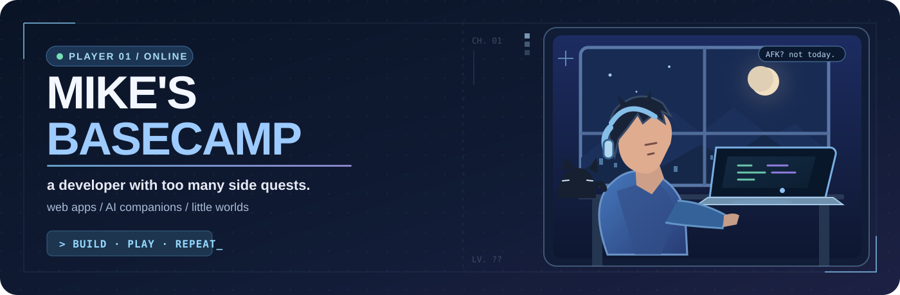
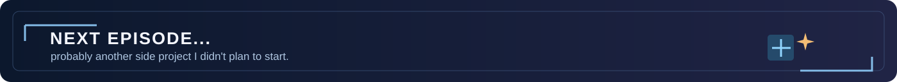

<div align="center">



**Hey, I'm Mike!** 👋 &nbsp; Developer, gamer, and serial side-quest starter.

*I like turning random ideas into things people can actually use — or at least have fun with.*

[**GitHub**](https://github.com/HoenMike) &nbsp;·&nbsp; [**Word Clock demo**](https://yet-another-vietnamese-word-clock.pages.dev/)

</div>

---

### `01 / PLAYER PROFILE`

I'm a developer who enjoys building **web apps, AI companions, and little interactive worlds**. Some projects start with a real problem. Others start with *"wait, wouldn't it be cool if…"*

I care about the small things: smooth interactions, good UX, and making something feel a bit more alive. If a project teaches me something new, that's already a pretty good quest reward.

> `current mood:` build something → break something → learn something → repeat.

### `02 / QUEST BOARD`

A few things I've been cooking lately:

| Quest | The story so far | Save slot |
| :--- | :--- | :--- |
| **🌱 Living Garden** | A cozy browser farming game about growing, exploring, and building a world at your own pace. | `IN PROGRESS` |
| **🤖 [Asumi](https://github.com/HoenMike/DiscordMikeBot)** | A Discord companion with AI conversations, community utilities, and useful automations. | `EVOLVING` |
| **☁️ Miraei** | A personal Telegram second brain for collecting thoughts, recalling context, and staying organized. | `PERSONAL PROJECT` |
| **🕒 [Word Clock](https://yet-another-vietnamese-word-clock.pages.dev/)** | A Vietnamese word clock for browsers and ambient displays, adapted from an [open-source project](https://github.com/tridzfr/vietnamese-word-clock). | `LIVE DEMO` |

<details>
<summary><b>↳ Bonus episodes — older builds and side quests</b></summary>
<br />

- **Zinit** — my graduation thesis: a Flutter productivity app for tasks, habits, and focus.
- **[Chrome Dino](https://github.com/HoenMike/ChromeDino)** — one of my first Java/OOP game projects. Tiny dinosaur, important memory.
- **ChillTown** — an experiment with real-time multiplayer experiences.

Not everything has a public repository. Some projects are private, but they're still part of the adventure.

</details>

### `03 / INVENTORY`

Tools I reach for when an idea becomes *"okay, let's actually build this"*:

<p>
  
  
  
  
  
  
</p>

**Main classes:** web development · game development · AI & automation  
**Passive skill:** opening a new side project before the last one is finished.

### `04 / DEV LOG`

```text
> booting mike's workspace...
> loading curiosity                         [OK]
> loading coffee                            [OK]
> checking side-quest count                 [TOO MANY]
> ready to build something                  [ALWAYS]
```

I started with little experiments and game projects. These days I bounce between product ideas, bots, interfaces, and making tiny worlds feel fun to explore.

<details>
<summary><b>↳ A little more about me</b></summary>
<br />

- I like projects with personality, not just a list of features.
- Games are a great excuse to learn something technically challenging.
- I keep experimenting with ways to make software feel more helpful and less complicated.

</details>

---

<div align="center">

**Thanks for dropping by my corner of GitHub.**  
Hope your code compiles and your bugs are easy to reproduce. ✦



<sub>Made with curiosity, late-night ideas, and a suspicious number of browser tabs.</sub>

</div>