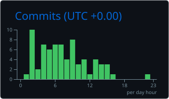

<!-- HoenMike's GitHub profile README: clean layout + anime atmosphere -->

# Hey, I'm Mike! 👋

**Developer · Web apps · AI & automation · Games**

*I like building useful things, experimenting with weird ideas, and making software feel a little more human.*

Vietnam 🇻🇳 · Usually coding, watching anime, or thinking about another side project.

  

 

---

## About me

I'm a Computer Science developer who enjoys working across **web applications, AI, automation, games, and business software**. Sometimes a project solves a real problem; sometimes I build it just to find out whether an idea can work.

I enjoy both the technical and human sides of development: understanding workflows, working with people, and making things that are pleasant to use. I've also worked around manufacturing environments, where practical software matters more than fancy buzzwords.

Outside of code, I'm into **anime, games, and a good story**. I like cozy games, thoughtful worldbuilding, and romance that actually makes you care about the characters.

## Selected projects

| Project | What it is |
| :--- | :--- |
| **🌱 [Living Garden](https://living-garden.hoanggg003.workers.dev/)** | A cozy browser farming game about growing things and building your own little world. |
| **🤖 [Asumi](https://github.com/HoenMike/DiscordMikeBot)** | A Discord bot with AI chat, community features, and automations. |
| **🕒 [Word Clock](https://yet-another-vietnamese-word-clock.pages.dev/)** | A Vietnamese word clock for web and ambient displays, adapted from an [open-source project](https://github.com/tridzfr/vietnamese-word-clock). |
| **🦖 [Chrome Dino](https://github.com/HoenMike/ChromeDino)** | An early Java / OOP game experiment. |

<b>More things I've worked on</b>

 

- **Zinit** — a Flutter productivity app and graduation project.
- **AlphaCMS 2** — scheduling and payroll management software.
- **ChillTown** — a real-time multiplayer experiment.
- **Other private projects** — internal tools, prototypes, and more experiments than I can keep track of.

## Tech & tools

Tools I've used across work and side projects, not a list of things I claim to have mastered.

## GitHub activity

<table>
<tr>
<td width="56%" align="center">

</td>
<td width="44%" align="center">

</td>
</tr>
</table>

Generated from public GitHub activity. Private and non-GitHub work may not appear.

<b>See more GitHub stats</b>

 

 

---

*Thanks for stopping by. See you around!*

Banner image: [source on X](https://x.com/hino_YT) · Widgets: [Typing SVG](https://github.com/DenverCoder1/readme-typing-svg), [Streak Stats](https://github.com/DenverCoder1/github-readme-streak-stats), [Profile views](https://github.com/antonkomarev/github-profile-views-counter) · [Summary Cards](https://github.com/vn7n24fzkq/github-profile-summary-cards) · [Snake](https://github.com/Platane/snk)

